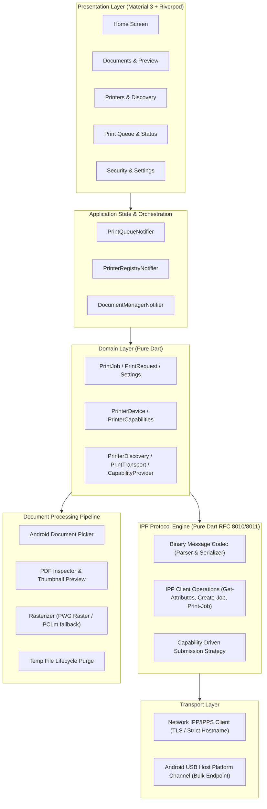

# BurePrint Architecture & System Specification

## 1. Architectural Vision
BurePrint is an open-source, local-first mobile printing application designed for Android with privacy by default. It provides reliable printing across Wi-Fi networks and USB OTG without cloud dependencies, user accounts, or telemetry.

---

## 2. Mandatory Visual Identity: Strict White and Blue

BurePrint strictly enforces a monochromatic white-and-blue visual design system:
- **Light Theme**:
  - Background & Light Surfaces: Pure White (`#FFFFFF`) and crisp off-white (`#F8FAFC`).
  - Brand, Navigation & Accents: Royal Blue (`#1D4ED8`), Primary Blue (`#2563EB`), Navy (`#1E3A8A`).
  - Text & Outlines: Slate Blue/Navy (`#0F172A`, `#334155`), Soft Borders (`#E2E8F0`).
- **Dark Theme**:
  - Background & Surfaces: Deep Midnight/Navy (`#0B132B`, `#1C2541`).
  - Brand & Highlights: Light Slate Blue (`#60A5FA`), Bright Blue (`#3B82F6`).
  - Text: Crisp White (`#FFFFFF`) and Ice Blue (`#E0E7FF`).
- **Forbidden Colors**: No green, red, orange, yellow, or purple. Statuses (Success, Error, Warning, Queued) are communicated via blue hues, typography, badges, and icons (e.g. checkmark, alert-triangle, hourglass) rather than red/green.

---

## 3. High-Level System Architecture

---

## 4. Layer Separation & Boundaries

1. **Presentation (`lib/features/`)**:
   - Flutter Material 3 widgets and screens.
   - Watches Riverpod state providers; never invokes network sockets, USB channels, or raw byte operations directly.
2. **Core & Theme (`lib/core/`)**:
   - Monochromatic White & Blue theme declaration (`theme.dart`).
   - Declarative navigation via `go_router` (`app.dart`).
   - Logging safeguards and sanitized error reporters.
3. **Domain Layer (`lib/domain/`)**:
   - Immutable data models (`PrintJob`, `PrinterDevice`, `PrintSettings`, `PrinterCapabilities`).
   - Abstract interfaces for transports (`PrintTransport`), discovery (`PrinterDiscovery`), and document converters.
   - Zero dependencies on Flutter widgets or native platform bindings.
4. **IPP Engine (`lib/core/ipp/` or `lib/data/ipp/`)**:
   - RFC 8010 binary encoding/decoding of tags, attributes, and frame structures.
   - RFC 8011 operation dispatching (`Get-Printer-Attributes`, `Print-Job`, `Create-Job`, `Send-Document`, `Get-Job-Attributes`, `Cancel-Job`).
   - Dynamic submission strategy selection.
5. **Data & Transport (`lib/data/`)**:
   - HTTP/IPPS client with per-printer TLS policies and explicit downgrade prevention.
   - DNS-SD/mDNS service discovery.
   - Local database/cache persistence for printer configurations and queue history.
6. **Platform Bridges (`android/` & `lib/platform/`)**:
   - Kotlin USB Host API manager (`UsbManager`, bulk endpoints, permission broadcast receiver).
