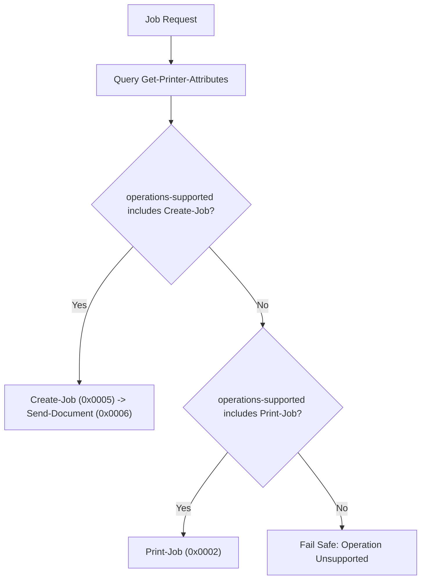

# Pure Dart IPP Protocol Implementation Plan (RFC 8010 & RFC 8011)

## 1. Overview
BurePrint implements the Internet Printing Protocol (IPP) stack directly in pure Dart. This provides cross-platform execution, zero C/JNI dependencies, and deterministic unit-testing with binary packet fixtures.

---

## 2. IPP Binary Message Structure (RFC 8010)

```
---------------------------------------------------------------------------
| Field Name               | Type      | Length (Bytes)                   |
---------------------------------------------------------------------------
| version-number           | signed    | 2 (major: 1 byte, minor: 1 byte) |
| operation-id/status-code | signed    | 2                                |
| request-id               | signed    | 4                                |
| attribute-group*         | composite | variable                         |
| end-of-attributes-tag    | tag       | 1 (0x03)                         |
| data (document payload)  | octets    | variable (optional)              |
---------------------------------------------------------------------------
```

### Attribute Groups & Tags
- Delimiter tags:
  - `0x01`: `operation-attributes-tag`
  - `0x02`: `job-attributes-tag`
  - `0x03`: `end-of-attributes-tag`
  - `0x04`: `printer-attributes-tag`
  - `0x05`: `unsupported-attributes-tag`
- Value tags:
  - `0x10`: `unsupported`
  - `0x12`: `unknown`
  - `0x13`: `no-value`
  - `0x21`: `integer`
  - `0x22`: `boolean`
  - `0x23`: `enum`
  - `0x30`: `octetString`
  - `0x31`: `dateTime`
  - `0x32`: `resolution`
  - `0x33`: `rangeOfInteger`
  - `0x41`: `textWithoutLanguage` / `0x35`: `textWithLanguage`
  - `0x42`: `nameWithoutLanguage` / `0x36`: `nameWithLanguage`
  - `0x44`: `keyword`
  - `0x45`: `uri`
  - `0x47`: `charset`
  - `0x48`: `naturalLanguage`
  - `0x49`: `mimeMediaType`

---

## 3. High-Level Operations (RFC 8011)

### 1. `Get-Printer-Attributes` (`0x000B`)
- **Required Parameters**: `printer-uri`, `attributes-charset` (`utf-8`), `attributes-natural-language`.
- **Requested Attributes**:
  - `printer-name`, `printer-make-and-model`
  - `printer-state`, `printer-state-reasons`
  - `operations-supported`
  - `document-format-supported`
  - `media-supported`, `media-default`
  - `sides-supported`, `color-supported`
  - `copies-supported`, `printer-resolution-supported`

### 2. Capability-Driven Submission Strategy


### 3. `Get-Job-Attributes` (`0x0009`) & `Cancel-Job` (`0x0008`)
- Poll job progress (`job-state`, `job-state-reasons`, `job-media-sheets-completed`) with exponential backoff.
- Issue `Cancel-Job` when requested by user; verify completion before updating UI state.

---

## 4. Error Handling & Parsing Defenses

- **Length-bounded parsing**: Reject packets where declared byte counts exceed buffer boundaries.
- **Truncated packet resilience**: Throw typed `IppMalformedMessageException` on premature EOF.
- **Unknown tags**: Gracefully skip unknown attribute tags without crashing.
